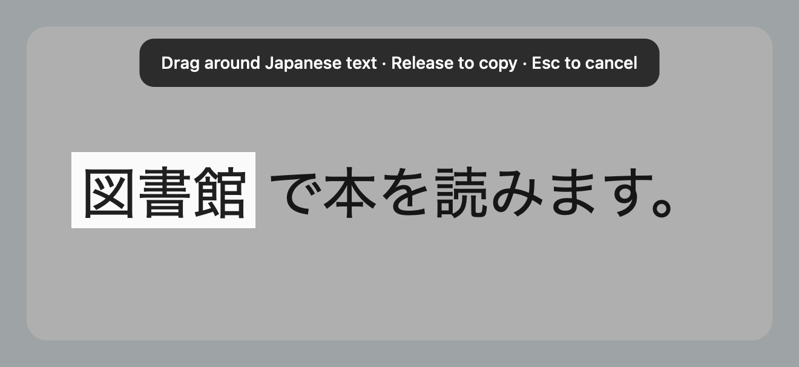
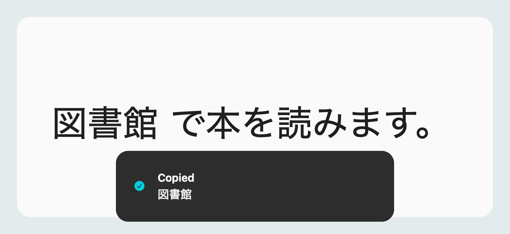

# Kiri

A little Mac app for copying Japanese text from your screen.

When you come across a kanji or sentence you don't understand, press **Command + Shift + 1**, drag around the text, and release. Kiri recognizes the text and copies it to your clipboard. Paste it into Yomitan, ChatGPT, Google Translate, Jisho, or another tool to look it up.

Useful for Japanese text in images and videos that you can't highlight and copy. Recognition runs locally using Apple Vision; Kiri saves no screenshots and needs no account or API key. Anything you paste into another service is handled by that service.

## Download

**[Download Kiri for Apple Silicon Macs](https://github.com/cobeycobb/Kiri/releases/latest/download/Kiri-Share-arm64.zip)**

Requires **an M1 or newer Mac and macOS 14 or later**. This download does not support Intel Macs or Windows.

## See Kiri in action

**1. Press Command + Shift + 1 and drag around the text you want.**

**2. Release to copy the text. Paste it with Command + V.**

## Set up

1. Unzip the download and drag **Kiri.app** into **Applications**. Open it from there.
2. This is a locally signed, **unnotarized** build. If macOS blocks it because the developer cannot be verified, try opening Kiri, then go to **System Settings → Privacy & Security → Open Anyway** and confirm. Only approve a download you trust. [Apple's instructions](https://support.apple.com/en-us/102445)
3. Click **Allow Screen Capture** in Kiri. In **System Settings → Privacy & Security → Screen & System Audio Recording** (or **Screen Recording**), enable Kiri. Quit and reopen it if macOS asks. [Apple's permission guide](https://support.apple.com/guide/mac-help/mchld6aa7d23/mac)
4. Keep Kiri running and press **Command + Shift + 1**, then release the keys. Drag around Japanese text and release to copy it. Paste with **Command + V**. Press **Escape** to cancel.

The shortcut is already configured in Kiri; you don't need to add it to macOS screenshot settings. It copies recognized **text**, rather than saving a screenshot image.

Click the viewfinder icon in the menu bar → **Settings** to change the shortcut or enable **Launch Kiri at login**. If the shortcut conflicts with another app, change that app's shortcut or pick another in Kiri. **Capture Text** in the menu bar works without a shortcut.

See [the full setup guide](SETUP.txt) for more help. Yomitan and other lookup tools are optional and installed separately.

## Build from source

On a Mac with macOS 14 or later and Apple's Command Line Tools installed, clone this repository and run `./scripts/build.sh` to build `dist/Kiri.app`. Run `./scripts/share.sh` to build a ZIP with the app and setup guide. The scripts build for the Mac's current architecture.

## Feedback

Found a bug or have an idea? **[Open an issue](https://github.com/cobeycobb/Kiri/issues/new/choose)**. For bugs, include your macOS version, Mac model, what you did, and what happened. Check [existing issues](https://github.com/cobeycobb/Kiri/issues) first.

For text-recognition problems, include the expected text and what Kiri copied. Share only non-sensitive examples; GitHub issues are public.

## Known limitations

OCR can miss or misread small, stylized, obscured, or tightly cropped characters. Select complete characters with a little surrounding space. Leave language correction off for individual kanji and unfamiliar words.

Vertical text, furigana, multiple physical displays, and launch at login have not been fully validated. This early release has not been tested on other people's Macs. Sometimes app stops working and requires a restart. 

The source code is available in this repository under the [MIT License](LICENSE).
